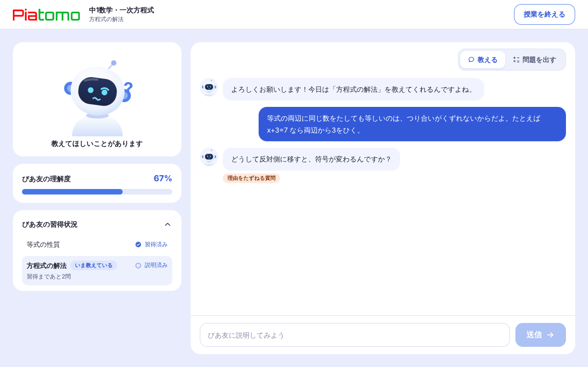
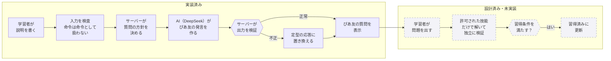
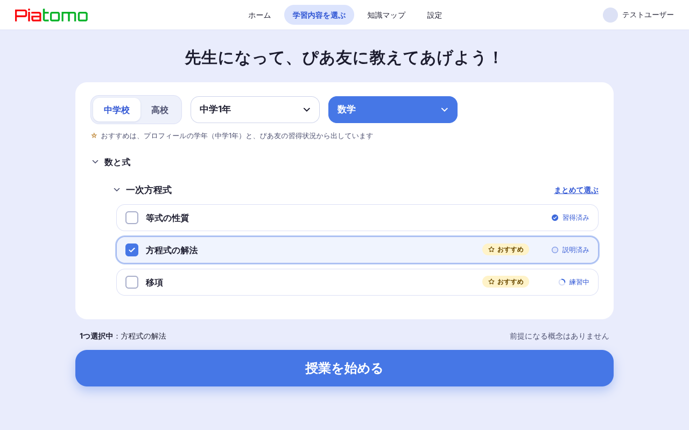
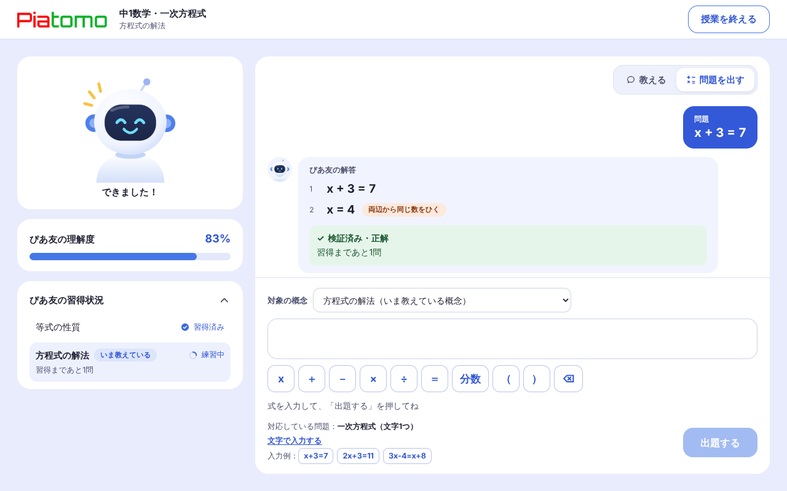
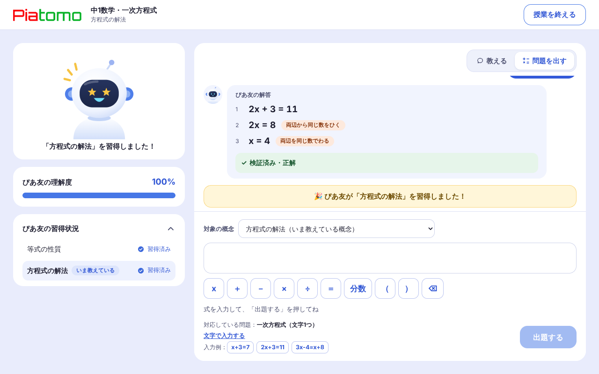
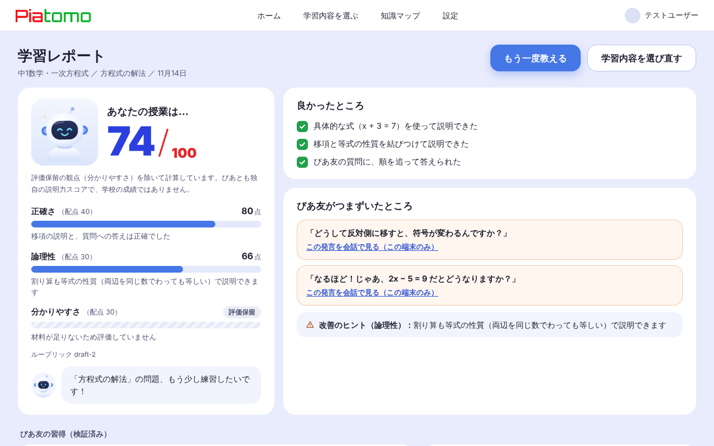
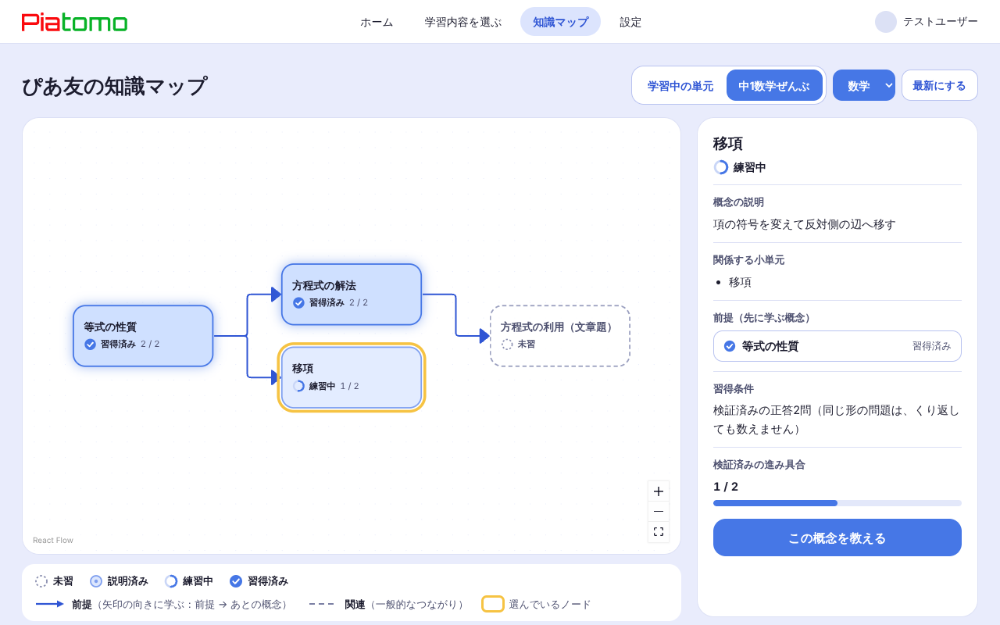
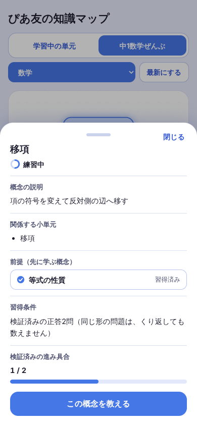

# ぴあとも（Piatomo）

**AIに教える学習アプリ。** 中学生・高校生が、同年代のAI生徒「ぴあ友」に勉強を教え、教えることで自分の理解を深めます。
TND 秋のハッカソン2026・チーム1。



*スクリーンショットは、疑似データ（モックAPI）で動かしたデモ版の画面です。実際のAIの応答や、習得の判定ではありません。*

| | |
|---|---|
| **動作URL** | **提出時点では、未配備です。** 配備の設定と手順書は用意しました（[docs/deploy.md](docs/deploy.md)）。ローカルで動かせるデモ版は、[4. 試してみる](#4-試してみる) |
| **画面の紹介** | [3. 画面](#3-画面)、詳しくは [docs/screens.md](docs/screens.md) |
| **できていること・いないこと** | [7. 現状](#7-現状)、詳しくは [docs/submission/status_and_unmet.md](docs/submission/status_and_unmet.md) |
| **仕様書・API契約** | [docs/](docs/README.md)、[contracts/openapi.yaml](contracts/openapi.yaml) |

## 1. 何のアプリか

- **ユーザー**：中学生・高校生。学年は、教材の推薦に使うだけで、学力や優劣を決めつけません。氏名・学校名・住所・正確な生年月日は、原則として取得しません。
- **やること**：教材（学習指導要領の小単元）を選び、ぴあ友に**教える**。ぴあ友は、分からないことを**質問**してきます。答えられるように、説明を言葉にして、直していきます。
- **学習の効果の考え方**：自分の言葉で教えることで、理解を深める「教える学習（ピアティーチング）」です。
- **ユーザーに返すもの**：説明力のレポート（正確さ・論理性・分かりやすさ。次に直すところつき）と、ぴあ友がどこまで習得したかの見える化。
- **しないこと**：学校の通知表の評価を決めること、何でも答えを出す汎用のAIチューター。説明力スコアは、**ぴあとも独自のもので、学校の成績ではありません。**
- **いまの対象（MVP）**：中学1年・数学・一次方程式の3つの小単元（等式の性質・方程式の解法・移項）。数式は、安全に検証できる範囲に限っています。

## 2. なぜAIなのか

**教える相手を、AIが務めるからです。** 学習者の説明は、一人ひとり違います。決まった台本では、「その説明のどこが分かりにくいか」を、質問できません。言語モデルは、説明の中身に合わせた質問を返せます。

**ただし、大事なことは、AIに任せません。** AIは「会話」だけを担当し、状態を決めるのは、サーバー（Django）です。

| | 役割 |
|---|---|
| AI（DeepSeek） | ぴあ友の発言を作る |
| サーバー（DRF） | AIに渡す内容を決める。AIの出力を検証し、不正なら捨てて、定型の応答に置き換える。**習得の状態を更新できるのは、サーバーだけ** |
| 数学の検証（設計） | 出された問題を、許可された技能だけで解いて、独立に検証する。検証できた正答だけを、習得の根拠にする |



**AIの発言だけでは、習得済みになりません**（自動テストで確認）。ただし、**検証済みの出題による習得判定そのものは、まだ実装していません**（[7. 現状](#7-現状)）。

## 3. 画面

流れ：ホーム → 教材選択 → 教える → 問題を出す → 習得 → レポート・知識マップ。画面ごとの説明は、[docs/screens.md](docs/screens.md)。

| | |
|---|---|
|  |  |
| **ホーム**：ぴあ友と、前回の続きの一言 | **教材選択**：学習指導要領の小単元を、複数選べる |
|  |  |
| **教える**：ぴあ友が、理由をたずねる質問を返す | **問題を出す**：数式を入力し、検証済みの解答と、使った技能を見る |
|  |  |
| **習得**：条件を満たすと、ぴあ友が喜ぶ（演出は1回だけ） | **学習レポート**：3観点の説明力。根拠が足りない観点は「評価保留」 |
|  |  |
| **知識マップ**：前提の矢印、4つの状態（文字とアイコン）、詳細 | **スマホ**：同じ情報と操作。詳細は下から出るシート |

**ぴあ友の6つの表情**（待つ・聞く・考える・質問する・できた・習得した）：


PCは幅1024px以上、スマホはそれ未満の配置です。キーボードでの操作、読み上げ用の名前、動きを減らす設定にも対応しています（[確認の記録](docs/a11y_check.md)）。

## 4. 試してみる

### 動作URL

提出時点では、**配備していません**。配備の設定（Firebase Hosting・Cloud Run）と手順書（[docs/deploy.md](docs/deploy.md)）までです。

### デモ版を動かす（ローカル。モックAPI）

```sh
git clone https://github.com/zawaumi/2026TND-Oct-Hackathon-Team1.git
cd 2026TND-Oct-Hackathon-Team1/apps/web
npm ci
npm run dev        # Windows の PowerShell では npm.cmd run dev
```

ブラウザで http://localhost:3000 を開きます（Node.js は `apps/web/.nvmrc` の版）。`NEXT_PUBLIC_API_BASE_URL` を設定しないと、モックのAPIで動きます。**ログインは不要**です。再読み込みすると、初期状態に戻ります。

**試す流れ**（約3分）：

1. ホームの「学習内容を選ぶ」→「方程式の解法」にチェック →「授業を始める」
2. 説明を書いて送る（例：`等式の両辺に同じ数をたしても等しいのは、つり合いがくずれないからだよ。たとえば x+3=7 なら両辺から3をひく。`）→ ぴあ友が質問を返す
3. 「問題を出す」に切り替えて、`x+3=7` → `x+5=9`（同じ形）→ `x^2=4`（範囲外）→ `2x+3=11`（違う形）を、順に出す
4. 習得の演出のあと、「授業を終える」でレポート、メニューの「知識マップ」で前提と状態を見る

**注意**：デモ版の「問題を出す」〜習得は、**モックの動きです**。実際の習得判定ではありません。画面に「デモ」の表示は出ないので、ここで明記します。

### 本物のAPIをつなぐ

[8. 開発者向けガイド](#8-開発者向けガイド)の手順3〜5です（DB・API・Webの順）。ただし、出題・検証・習得判定のAPIは、未実装です。

## 5. セキュリティとプライバシーの工夫

「確認」は、自動テスト（`apps/api` の `python manage.py test`、`apps/web` の `npm run test:*`）か、実際に動かして確認したものです。

| 工夫 | 内容 | 確認 |
|---|---|---|
| 本人確認 | Firebase のIDトークンの署名と有効期限を検証。`alg: none`・改ざん・形式の誤りは401 | `accounts.test_auth`（`test_alg_none_is_rejected`、`test_tampered_payload`、`test_bad_tokens_are_401`） |
| 本人以外に見せない | 他人の授業・レポート・ぴあ友の知識・私有の教材は、見えない（404） | `test_other_users_session_is_404`、`test_other_users_report_is_not_found`、`test_other_users_state_is_not_visible`、`test_private_lesson_of_others_is_hidden` |
| AIの出力を信用しない | 出力を検証し、不正（例：`master_all`）は捨てて、定型の応答にする。知識は変わらない | `test_bad_ai_output_falls_back_without_changing_knowledge`、受入試験 `AT03` |
| AIの発言で習得済みにならない | 習得済みにできるのは、習得判定だけ。AIが「分かった」と6回言っても、習得済みにならない | `test_advance_one_step_only`、`learning/test_acceptance.py` の `AT03` |
| 不正な入力への対策 | 命令のような入力は、データとして扱い、知識や採点規準を変えない。プロンプトと入力を分ける | `test_classify`、`test_injection_like_input_does_not_change_knowledge`、`test_suspicious_input_is_not_used_for_scoring`、`test_prompt_and_input_are_separated` |
| 外部のAIに渡す情報を最小にする | 識別子を送らない。個人情報を伏せる。渡す文脈を制限する | `integrations.tests.PayloadTests`、`test_payload_to_ai_has_no_identifiers` |
| 会話の本文を保存しない | DBの全テーブルを検索して、会話の本文が残っていないことを確認 | `learning/test_acceptance.py` の `AT10` |
| 二重送信・競合 | 同じ`request_id`は1回だけ処理。同じIDで本文が違えば409 | `test_same_request_id_returns_same_result_without_reprocessing`、`test_same_request_id_with_different_content_is_409` |
| 数式の入力 | LaTeXを画面で評価しない。許可した記号だけを送り、結果は文字として出す | `npm run test:math` |
| 本番の設定 | 管理画面のURLを出さない。秘密鍵が必須。ワイルドカードのホストを拒否。APIの応答をキャッシュしない | `config.tests`（`ProductionSettingsTests`、`ApiNoStoreTests`） |
| CORS | 許可していない呼び出し元には、CORSのヘッダーを出さない | `test_other_origin_gets_no_cors_headers` |
| 秘密の管理 | 秘密の値はリポジトリに入れない（`.gitignore`、`.env.example` は架空の値）。本番はSecret Manager（[手順書](docs/deploy.md)）。モックAPIが本番ビルドに混ざらない検査（`check-no-mock`）をビルドの最後に実行 | `apps/web/scripts/check-no-mock.mjs`（CIのビルドで実行） |

**まだできていない安全対策**：退会・データ削除、攻撃耐性の全体の試験、外部AIの利用条件と、未成年の同意の確認（法務）。詳しくは [docs/submission/status_and_unmet.md](docs/submission/status_and_unmet.md)。

## 6. 技術構成

```
apps/web/    Web（Next.js + TypeScript + Tailwind。静的出力）
apps/api/    API（Django REST Framework）
contracts/   API契約（OpenAPI）
docs/        仕様書
compose.yaml ローカルDB（PostgreSQL）
```

| 領域 | 使っているもの |
|---|---|
| 画面 | Next.js（静的出力）、TypeScript、Tailwind CSS、MathLive（数式入力）、React Flow（知識マップ）、Motion（アバター） |
| API | Django、Django REST framework、PostgreSQL |
| 認証 | Firebase Authentication（Googleログイン）。APIはIDトークンを検証 |
| AI | DeepSeek（ぴあ友の会話）。Jev（評価）は、まだ接続していません |
| 公開（設計） | Firebase Hosting（画面）、Cloud Run（API）、Cloud SQL（DB） |
| CI | GitHub Actions（`web-ci`、`api-ci`）。マージにはCIの成功が条件 |

構成の詳細は、[docs/01_architecture.md](docs/01_architecture.md)。使っているライブラリとライセンスは、[docs/submission/status_and_unmet.md](docs/submission/status_and_unmet.md) の10節です。

## 7. 現状

仕様書は、「完成したソフトウェアや検証済みの教育効果を主張するものではない」という立場です。**動くものと、まだ動かないものを、分けて書きます。**

| | 状態 |
|---|---|
| ログインの本人確認、初回登録、教材選択、「教える」会話、学習レポート、知識マップ | **動く**（API・画面。外部AIはモック。実際のFirebase・DeepSeekとの接続は未確認） |
| 出題 → 検証 → 習得判定 | **APIが未実装。** 画面は、デモ版（モック）で動く |
| 退会・データ削除、知識リセット、設定の画面 | **未実装** |
| 知識マップの前提の矢印 | デモ版では出る。**本物のAPIでは、前提関係のモデルが未実装のため、出ない** |
| 動作URL（配備） | **未配備** |
| 採点の比較実験（DeepSeekとJev） | 準備のみ（[データと採点ツール](docs/experiments/scoring/README.md)）。**採点は未実施。** Jevは未接続 |
| レスポンシブ・アクセシビリティ | 確認済み（幅1280・390、キーボード、axe）。実機・スクリーンリーダーは未確認 |

- 試験の記録：[docs/e2e_acceptance.md](docs/e2e_acceptance.md)、[docs/a11y_check.md](docs/a11y_check.md)
- 教材の対象と出典：[docs/materials/](docs/materials/mvp_scope_and_sources.md)
- **生成AIの利用**：開発に、Claude・GitHub Copilot（コードと文書）、ChatGPT（ホームの画像）を使いました。内容は、人が確認しています（[詳細](docs/submission/status_and_unmet.md)の9節）。

## 8. 開発者向けガイド

ここから先は、リポジトリを手元で動かす人向けの手順です。

### 1. 前提ソフト

| ソフト | 版 | 用途 |
|---|---|---|
| Git | 最近のもの | |
| Python | 3.12 | API |
| Node.js | `apps/web/.nvmrc` の版（26）。[nvm](https://github.com/nvm-sh/nvm) なら `cd apps/web && nvm install && nvm use` | Web |
| Docker（Compose v2） | 最近のもの | ローカルのPostgreSQL（**使わなくてもAPIは起動できる**。手順3参照） |

### 2. 環境変数

```sh
cp .env.example .env
```

`.env` を開いて、`POSTGRES_PASSWORD` を自分用の値に変えます（ローカル専用なので何でもよい）。

- `.env` は **Gitに入りません**（`.gitignore` で除外済み）。**コミットしないでください。**
- `.env.example` には**架空の値だけ**を置きます。本物のパスワード・APIキー・Firebaseのサービスアカウント鍵（`*.json`）は、どのファイルにも書かず、PRにも含めません。
- Webの環境変数（`NEXT_PUBLIC_*`）は**ブラウザに公開される**ので、秘密の値を入れません。

| 変数 | 使う場所 | 内容 |
|---|---|---|
| `POSTGRES_DB` `POSTGRES_USER` `POSTGRES_PASSWORD` `POSTGRES_HOST` `POSTGRES_PORT` | Docker・API | DB接続。**5つすべて設定するか、すべて未設定**にする（一部だけだとAPIがエラーになる） |
| `DJANGO_SECRET_KEY` | API | 未設定なら起動のたびに自動生成。本番では必須 |
| `DJANGO_SETTINGS_MODULE` `DJANGO_ALLOWED_HOSTS` | API（本番） | 本番だけ必須。ローカルでは不要 |

### 3. DBを起動する（Docker）

```sh
docker compose up -d db
docker compose ps        # db が healthy になるまで待つ
```

Dockerを使わない場合は、手順2の `POSTGRES_*` をすべて消す（または未設定にする）と、APIは SQLite（`apps/api/db.sqlite3`）で動きます。

### 4. APIを準備して起動する

```sh
cd apps/api
python3 -m venv .venv
source .venv/bin/activate
pip install -r requirements.txt

# .env の値をこのターミナルに読み込む（DBにPostgreSQLを使うとき）
set -a; source ../../.env; set +a

python manage.py migrate     # DBの初期移行
python manage.py runserver   # http://127.0.0.1:8000
```

確認: ブラウザかターミナルで `http://127.0.0.1:8000/api/v1/health/` を開くと `{"status":"ok","service":"piatomo-api"}` が返ります（プロセスの稼働確認で、DBの接続確認ではありません）。

> ターミナルを開き直すたびに、`source .venv/bin/activate` と `set -a; source ../../.env; set +a` が必要です。

### 5. Webを起動する

別のターミナルで:

```sh
cd apps/web
nvm use                # .nvmrc の版に切り替え（nvmを使う場合）
npm ci                 # 依存の導入（package-lock.json どおり）
npm run dev            # http://localhost:3000
```

`NEXT_PUBLIC_API_BASE_URL` を設定しないときは、画面は**モック**（`src/lib/api/mock.ts`）で動きます。API（手順4）を起動していなくても、画面は確認できます。モックの合図などは [`apps/web/README.md`](apps/web/README.md) を参照してください。

現時点のAPIは `health` だけで、ブラウザからのアクセス許可（CORS）も未設定のため、WebをAPIにつなぐのはAPIの実装が進んでからです。つなぐときは `apps/web/.env.local`（Git管理外）に `NEXT_PUBLIC_API_BASE_URL=http://localhost:8000` を書きます。

### 6. テスト・検査

```sh
# API（apps/api で、venv を有効にして、手順4の環境変数を読み込んだうえで）
python manage.py check
python manage.py test accounts config

# Web（apps/web）
npm run lint
npm run typecheck
npm run build            # 静的ビルド → out/（Google Fonts を取得するためインターネット接続が必要）

# API契約（リポジトリ直下）
python3 -m venv contracts/.venv
contracts/.venv/bin/python -m pip install -r contracts/requirements.txt
contracts/.venv/bin/openapi-spec-validator contracts/openapi.yaml    # "OK" が出れば成功
```

PRを出すと、変えた場所に応じて自動チェック（CI）が動きます。動くチェックの一覧は `.github/workflows/` にあります。CIの結果を待つ前に、手元でも上のコマンドを実行しておくと、失敗に早く気づけます。

### 7. 終了・後片づけ

| やりたいこと | コマンド | 影響 |
|---|---|---|
| APIやWebを止める | そのターミナルで `Ctrl + C` | なし |
| DBを止める | `docker compose down` | **DBのデータは残る** |
| DBを止めて**データも消す** | `docker compose down -v` | **DB内のデータがすべて消える**（やり直したいときだけ） |

`.env` の `POSTGRES_DB` `POSTGRES_USER` `POSTGRES_PASSWORD` を変えても、**すでに作られたDBには反映されません**。変えたいときは `docker compose down -v` で作り直します。
ホスト側のポート5432が使用中なら、`.env` の `POSTGRES_PORT` を変えます。

### 8. ブランチ・PR・レビュー

1. `main` から、1つのIssueにつき1つの短いブランチを作る（新機能は `feat/<Issue番号>-<内容>`、修正は `fix/<内容>`）。
2. 変更をコミットして push し、PRを作る。説明欄に `Closes #<Issue番号>` を書く。
3. PRに、**実行した確認コマンドと結果、未実施の項目**を書く。
4. 受け入れ条件を確認し、CIが成功していることを確かめる。**レビューを最低1人**から受ける。
5. レビュー済みで、CIが成功していれば `main` にマージする。`main` はいつでもデプロイできる状態に保つ。

**秘密情報を誤ってコミットしたときは、PRを出す前に（または出してすぐに）チームに伝えてください。** 一度公開した鍵は、履歴から消しても無効にする（再発行する）必要があります。

### 9. API契約（`contracts/openapi.yaml`）を変えるとき

1. APIの要求・応答・認証・エラーを変えるPRでは、**同じPRで** `contracts/openapi.yaml` を更新する（必要なら仕様書とサンプルも）。
2. 手順6の「API契約」の検証コマンドで `OK` を確認する。
3. Webの型を作り直す: `cd apps/web && npm run gen:api`（`src/lib/api/schema.d.ts` が更新される。差分も同じPRに含める）。
4. 決定を伴う変更は、`docs/08_decisions_and_open_items.md` の表に1行足す。
5. PRに、変更内容・検証結果・未実装や未確認の項目を書く。契約草案と実装済みのAPIは区別して書く。

### 10. 本番公開

画面は Firebase Hosting、API は Cloud Run、DB は Cloud SQL に置きます。手順は [`docs/deploy.md`](docs/deploy.md) にまとめました（`firebase.json` が配信と `/api/**` の転送を決めています）。秘密の値は Secret Manager にだけ置きます。

### よくあるつまずき

| 症状 | 原因と対処 |
|---|---|
| `Missing PostgreSQL settings: ...` | `POSTGRES_*` が一部しか設定されていない。5つすべて設定するか、すべて外す |
| `docker compose` が `Set POSTGRES_DB in .env` と言う | リポジトリ直下に `.env` がない。手順2を実行する |
| DBに接続できない | `docker compose ps` で `healthy` か確認。ポート使用中なら `POSTGRES_PORT` を変える |
| `npm run build` が失敗する（フォント取得エラー） | インターネットに接続できていない。接続してから再実行する |
