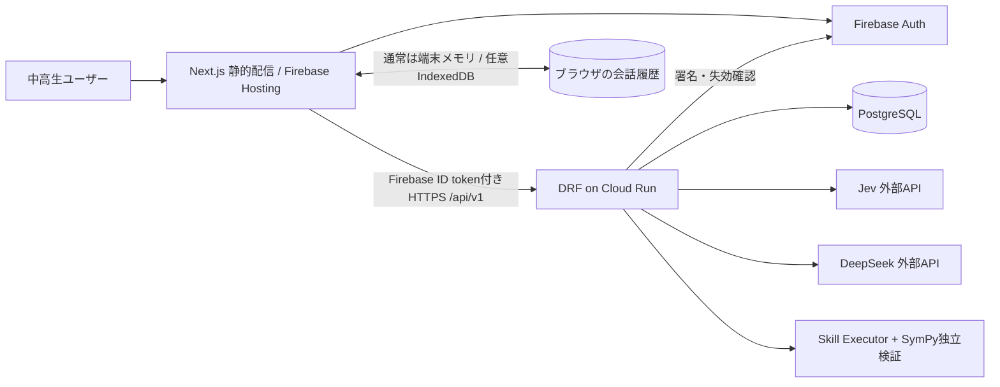

# システムアーキテクチャ詳細設計

**版** 1.1 / **改訂日** 2026-11-08 / **要求参照** FR-01, FR-03〜08, NFR-01, SEC-01, PR-01

## A. 信頼境界と配置



- ブラウザは信頼できない。認証トークンが有効でも、本人以外のリソースへのアクセス権はない。
- DRFが**唯一の学習状態更新主体**。AIサービスは状態遷移候補/言語表現の生成者に過ぎない。
- PostgreSQLが学習の状態と履歴の正本。ブラウザの会話は画面に表示するためだけのもので、習得の判定などの根拠には使わない。
- ユーザーが入力した文字列を、教材や評価規準を変える命令として扱わない。

## B. ディレクトリと依存関係

```text
piatomo/
  apps/
    web/                 Next.js / TypeScript / Tailwind（Node.js 26、.nvmrc）
      src/app/           /, /lessons/, /study/, /report/, /knowledge/, /settings/
      src/components/    avatar/, chat/, graph/, exercises/, evaluation/
      src/lib/           firebase.ts, api.ts, session-store.ts
    api/                 Django + DRF
      config/            settings, urls
      accounts/          custom User, FirebaseAuth, onboarding, deletion
      peers/             Peer, PeerKnowledge, state transition
      lessons/           curriculum, Lesson, Concept, MasteryPolicy
      sessions/          LearningSession, LearningTurn, service orchestration
      exercises/         Problem, Attempt, SkillExecutor, verification
      evaluations/       Rubric, Criterion, Evaluation
      integrations/      deepseek, jev, firebase admin adapters
  infra/                 cloudrun, deployment settings
  docs/                  specifications
  contracts/             OpenAPI, examples
  .github/workflows/     web-ci（lint・型検査・ビルド）, api test, deploy
  compose.yaml           local PostgreSQL
  firebase.json          Firebase Hosting rewrite
```

プロジェクト依存はwebとapiで別管理。Docker Composeは最低限PostgreSQLを提供し、web・apiはローカル起動でホットリロードを優先。nginxは使わない（ADR-014）。本番はFirebase Hostingが`/api/**`をCloud Runへ転送し、ローカルはwebとapiを別ポートで起動する。

## C. 認証フロー
1. Firebase AuthでGoogleアカウントによりログインする（MVPはGoogleのみ。匿名のお試し利用は扱わない。ADR-016）。ログイン状態の永続保持は初期ではブラウザのセッション単位。
2. Next.jsが`user.getIdToken()`を用いてIDトークンを取得。
3. `Authorization: Bearer <id_token>`でDRFへ送信。
4. DRFがFirebase Admin SDKで署名・対象プロジェクト・有効期限等を検証。失効検査はプライバシー操作と通常APIでリスク/性能を比較した上で適用。
5. 初回設定と必要な同意を記録した時点で、初めてDBに`User`を作る。`GET /users/me/`を呼んだだけで自動的にアカウントができる作りにはしない。
6. リソースIDは常に`owner=request.user`で絞る。詳細を漏らさないよう所有外IDは404。

## D. チャットメッセージの扱い
- `Message`全文のDB保存は原則廃止。必要な短期文脈はNext.jsコンポーネント状態に保持、設定をオンにした場合のみIndexedDBに保存。
- APIリクエストは直近文脈の最小限を含められるが、**クライアント履歴は改ざん可能**。新概念の習得判定にはサーバー側の検証記録のみを使う。
- DRFはレスポンス本文を必要最小限のメモリで保持し、リトライ用`LearningTurn`は応答の短い一時キャッシュ/TTL付きとする。
- ユーザーが過去会話の完全復元を希望する場合の端末内保存はプライバシー説明の上でオプトイン。

## E. 1ターンの競合制御
1. `LearningTurn(session, request_id)`の一意制約で、新しい送信か再送かを判定する。同じ`request_id`なのに本文（`input_hash`）が違えば409を返す。
2. 1つの授業で、同時に2つ以上のターンを確定しない。前のターンを処理中なら、同じ送信の再送には202（処理中）、別の送信には409を返す。
3. トランザクション外でAIを実行し、**外部API呼び出し中にPostgreSQL行ロックを保持しない**。
4. 確定時に`Peer`を`select_for_update()`し、`knowledge_version`、セッション状態、リセット世代を再検証。
5. バージョン変更時は古い応答・習得変更を廃棄し、`STALE_CONTEXT`として再取得を促す。
6. 状態を確定してから処理済み結果を短期キャッシュ。失敗時には安全な再実行を許可する。

## F. 処理の同期待ち / ストリーミング
MVPはHTTP POSTでJev→DRF判定→DeepSeek→DRF検証→JSONを返す。JevとDeepSeekに相互依存があるため原則直列で、独立な評価質問だけJevの1回の呼出しにまとめる。DeepSeekの未検証トークンを利用者へストリーミングしない。画面側は「考え中」等のUI状態で待機する。

## G. 本番構成
- Firebase Hostingは`apps/web/out/`を配信し、`/api/**`をCloud Runサービスへrewrite。Cloud Runはasia-northeast1を候補。
- Next.jsは`output: "export"`。未事前生成の動的パス、SSR、Server Actions等の利用は避け、`/study/?session=<id>`等を利用する。
- Secret Manager等でDeepSeek/Jev/DB接続情報を保護。Firebase Adminの認証情報はCloud Runのサービスアカウントを優先。
- Cloud Runの同時処理・最小インスタンス数は計測後に調整。Cloud SQLコストと接続数に注意。
- Firebase Hostingのrewriteには60秒のHTTP制限があるため、タイムアウトする会話は成功として扱わない。

## H. 状態監視
`request_id`、`session_id`（できれば、元のIDに戻せない形に変えた、短期間だけ使う識別子）、結果コード、処理ms、AIモデル識別子、フォールバック有無、バージョン競合件数を観測する。会話内容・身元識別子・Bearerトークンをログに残さない。
