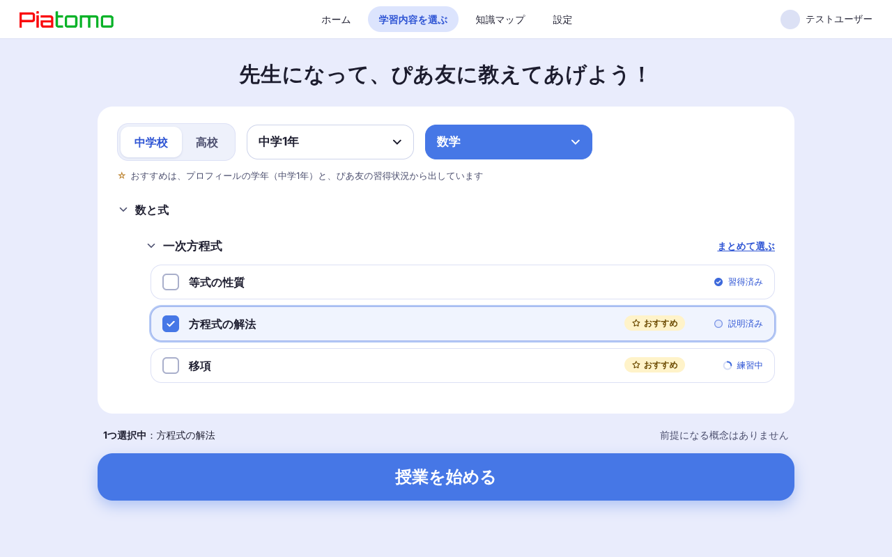
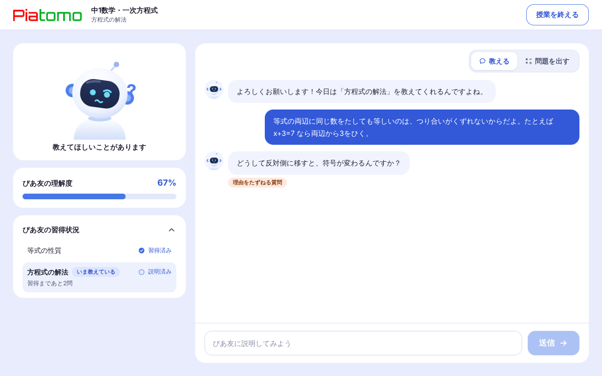
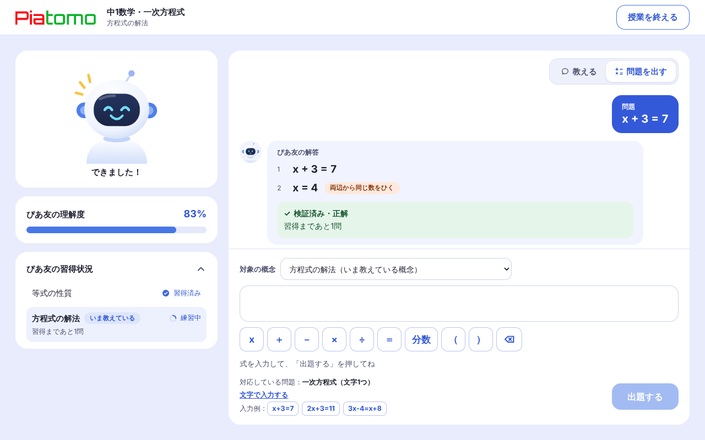
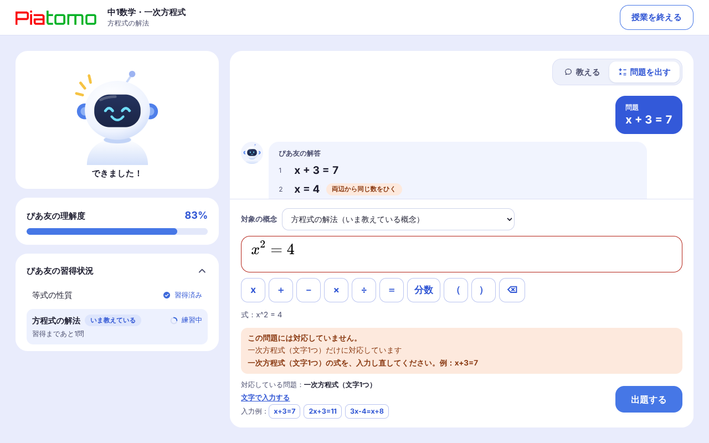
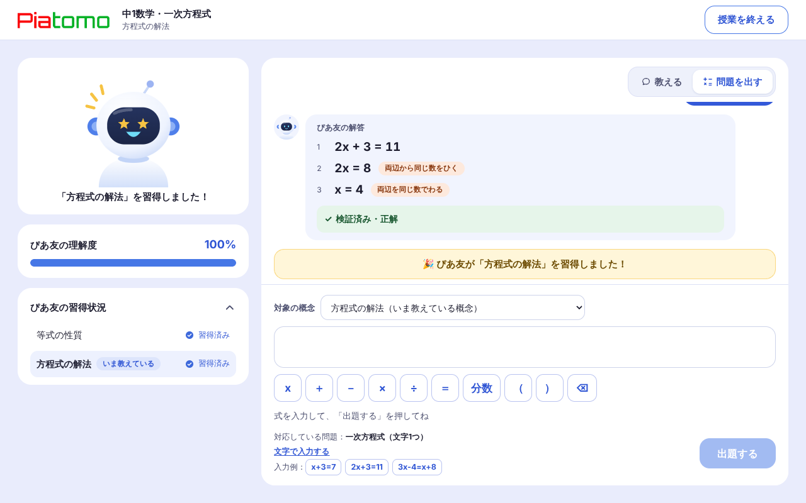
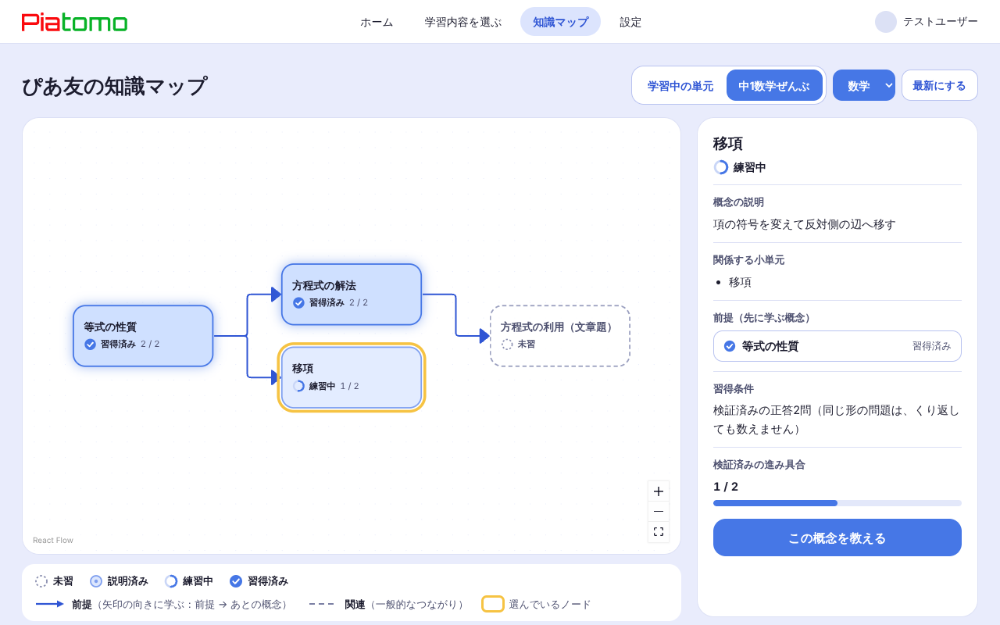
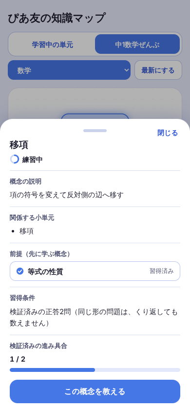
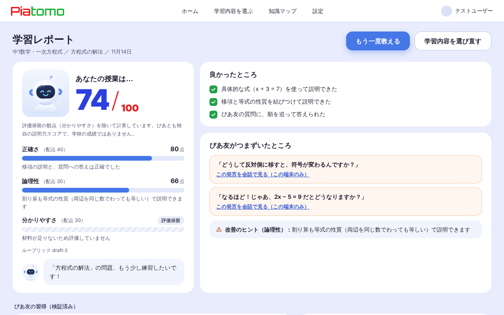

# 画面ガイド

ぴあとも（Piatomo）の画面の説明。スクリーンショットは、**モックAPIで動かしたデモ版**の画面で、実際のAIの応答や、習得の判定ではない。PC は幅 1024px 以上、スマホはそれ未満の配置（ADR-024）。

## 共通

- **ナビ**：PC は上部に「ホーム・学習内容を選ぶ・知識マップ・設定」。スマホは下部のタブバー（ホーム・学習内容・知識マップ・設定）。**スマホのタブバーは、ホーム・学習ルーム・学習レポートでは出さない**（ADR-025・ADR-038）。
- 「設定」の画面は、**まだない**（ナビのリンク先は 404）。
- **色だけに頼らない**：状態は、文字とアイコンの形でも区別する。動きを減らす設定では、アバターは止まった絵になる。
- キーボードだけで操作でき、フォーカスの位置が見える（[確認の記録](a11y_check.md)）。

## ログインと初回設定

- **ログイン**：Googleでログイン（Firebase）。ログインが切れたときは、ログイン画面に戻り、続きの画面に戻れる。
- **初回設定**：ニックネーム・校種・学年を入れ、データの扱いの説明を読んで、同意する（同意のチェックが必須）。同意の文面は**仮**（法務の確認前）。
- デモ版は、ログイン済みとして動くので、どちらも出ない。確かめるには、`?mock=unauthorized`（ログイン）、`?mock=newUser`（初回設定）を、URLの最後に付ける。

## ホーム

- ロゴ、ぴあ友、前回の続きの一言（「前回は最後に〇〇を学習したよ！」）、3つのボタン（学習内容を選ぶ・知識マップ・設定）。
- **スマホ**は、吹き出しを出さず、ロゴ → ぴあ友 → ボタンの順に、縦に並べる。ナビ・タブバーは出さない。
- 最近の学習が取れなくても、ボタンは使える（エラーは吹き出しの中に出す）。

## 教材選択

- 見出し「先生になって、ぴあ友に教えてあげよう！」。校種・学年・教科を選び、**領域 → 単元 → 小単元**をたどる。
- 小単元は、**複数選べる**（10個まで）。単元ごとに、「まとめて選ぶ」もできる。
- 小単元に、ぴあ友の状態（習得済み・説明済み・練習中）と、「おすすめ」が付く。おすすめは、プロフィールの学年と、ぴあ友の習得状況から出す。
- 選んだ小単元と、前提になる概念を、下に出す。「授業を始める」で、学習ルームへ進む。
- 公開しているのは、中学1年の数学・一次方程式の3小単元（等式の性質・方程式の解法・移項）。

## 学習ルーム：教える

- **PC**：左に、ぴあ友（表情と一言）、**ぴあ友の理解度**、**ぴあ友の習得状況**（いま教えている小単元の概念と状態、「習得まであと〇問」）。右に、会話と入力欄。
- **スマホ**：上に、ぴあ友と理解度と習得状況のカード。その下に、会話と入力欄。下に、「教える」「問題を出す」の切り替え。
- 説明を送ると、ぴあ友が**質問を1つ**返す。質問には、種類のラベル（例：「理由をたずねる質問」）が付く。
- 送信中は、ぴあ友が「考え中…」になり、入力と切り替えを止める。通信に失敗したときは、再送できる（同じ送信は、1回だけ処理される）。
- 「授業を終える」で、確認のあと、学習レポートへ進む。

## 学習ルーム：問題を出す

| | |
|---|---|
|  |  |
| 検証済みの解答（式と、使った技能を、1行ずつ） | 対応していない式の案内（式は消えない） |

- **対象の概念**：いま教えている概念が初期値で、選び直せる。
- **数式の入力**：MathLive の入力欄。記号のキー（x・＋・－・×・÷・＝・分数・かっこ・1文字消す）、入力した式の読み上げ用の言葉、「文字で入力する」への切り替え、入力例がある。
- **結果の表示**
  - 検証済み・正解：「習得まであと〇問」
  - 前と同じ形：正解でも、習得の回数に入れない。違う形の例を出す
  - ぴあ友が止まった：まだ教わっていない技能を表示し、「教えるモードで説明する」へ誘う
  - 対応していません：理由と、入力し直しの案内を出す（式は残す）
  - 検証できません：習得には使わないと伝える
- **習得の演出**：サーバーが習得済みへの遷移を確定したときだけ、アバターが喜ぶ（星の目と紙吹雪）。**同じ確定イベントでは、1回だけ。**

**デモ版での入力例**

| 入力 | 起きること |
|---|---|
| `x+3=7` | 検証済み・正解 |
| `x+5=9`（`x+3=7` のあと） | 前と同じ形で、回数に入らない |
| `x^2=4` | 対応していない |
| 分数キーで `x/2=3` | ぴあ友が止まる（教わっていない技能） |
| `2x+3=11` | 違う形の正答がそろい、習得済みになる |

## ぴあ友の6つの表情

待つ・聞く・考える・質問する・できた・習得した。**表情は、知識の状態とは別**で、「習得した」の表情は、サーバーが習得済みへの遷移を確定したときだけ使う。ぴあ友の発言が「できた！」でも、確定していなければ、「できた」の表情にとどめる。

## 知識マップ

- ぴあ友の知識を、**概念のノード**と、**前提の矢印**（前提 → あとの概念）で出す。ドラッグと拡大縮小ができる。
- 状態は4つ：**未習・説明済み・練習中・習得済み**。色だけでなく、文字と、形の違うアイコン（点線の輪・淡い点灯・進捗の輪・チェック）で区別する。凡例つき。
- ノードを選ぶと（黄色の枠）、**概念の説明・関係する小単元・前提・習得条件・検証済みの進み具合**が出る。習得条件の文は、APIの数値から作る。
- 範囲は、「学習中の単元」と「中1数学ぜんぶ」を切り替えられる。
- キーボードでは、Tab でノードへ移り、Enter で選び、Esc で外す。
- **スマホ**は、ノードの上下に並べ、詳細は下から出るシートに出す（下に引くか、「閉じる」か、Esc で閉じる）。

※本物のAPIでは、前提関係のモデルが未実装のため、**前提の矢印は出ない**（デモ版では出る）。

## 学習レポート

- **説明力スコア**（ぴあとも独自のもの。学校の成績ではない）を、3観点（正確さ・論理性・分かりやすさ。配点は仮）で出す。根拠が足りない観点は、「評価保留」にして、点数を出さず、残りの観点で割り戻す。
- 「良かったところ」（3件まで）、「ぴあ友がつまずいたところ」（会話の発言を見る。この端末のみ）、「改善のヒント」、ぴあ友の習得の変化（検証済み）、次の教材の提案。
- 「もう一度教える」「学習内容を選び直す」。
